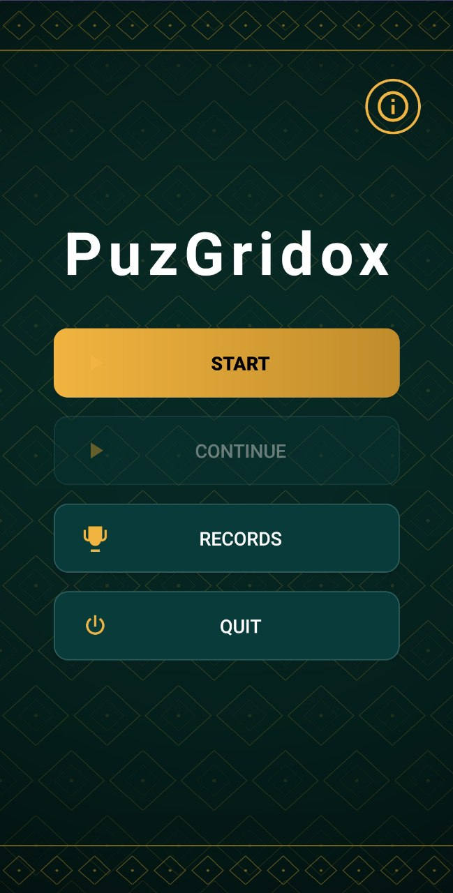
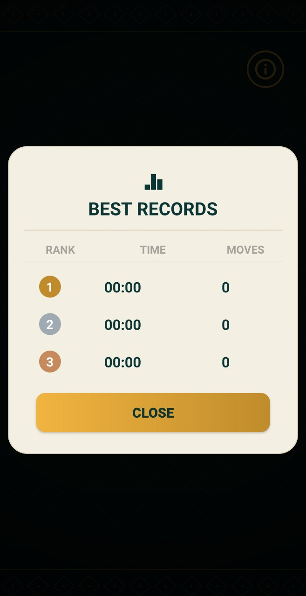
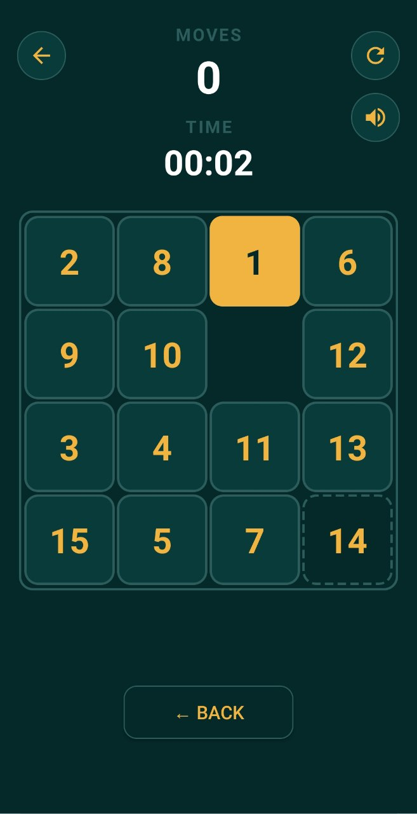
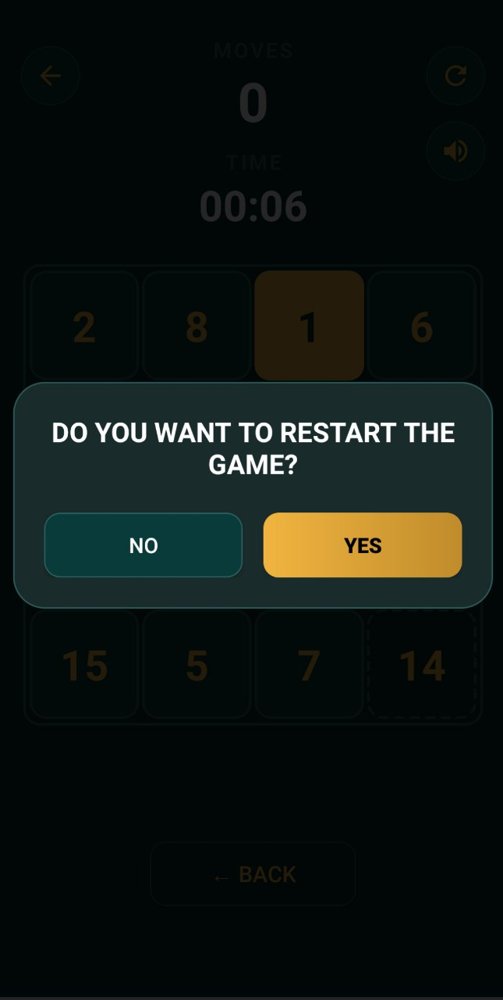
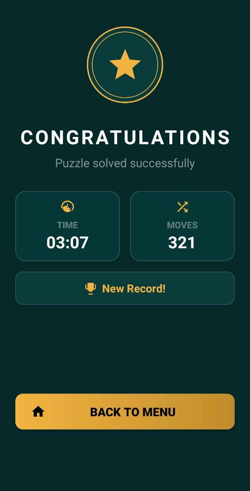

# PuzGridox

A classic 15-puzzle (sliding tile) game for Android.

> 🧪 Currently in testing on Google Play. The link will be added after release.

> 📚 **Note:** This project was created while I was learning Android development. The code is not perfect and may contain mistakes or messy parts. I'm improving it as I learn.

## Screenshots

  
  
  

  
  
  

## How to play
- Arrange tiles from 1 to 15 in order.
- Slide a tile into the empty space.
- Fewer moves and less time means a better record.

## Features
- Player name login
- Timer and move counter
- Top 3 records (Records screen)
- Continue your last game
- Sound effects
- Restart and exit confirmation dialogs

## Tech
- Language: Java
- Platform: Android (min SDK 24)
- IDE: Android Studio

## Author
Asadbek
